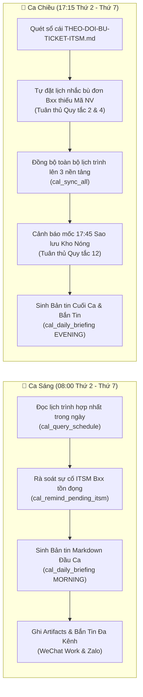

# ⏰ BÁO CÁO CHI TIẾT: LỊCH QUÉT & VẬN HÀNH TỰ ĐỘNG HÀNG NGÀY (TASK SCHEDULER & SIDECARS)

> **Dự án:** `DUC_CalendarSync_AIBridge` (v1.3.0 → v1.4.0)  
> **Chuyên đề:** Kiến Trúc Tự Động Hóa Kép Ca Sáng / Ca Chiều qua Windows Task Scheduler & Antigravity Scheduled Automations  
> **Tác giả:** Nguyễn Duy Đức (`DucWorker97` — `ducworker97@users.noreply.github.com`)  
> **Hệ sinh thái:** `DUC_SmartOps_AIHub`  
> **Ngày hoàn thành:** 09/11/2026  

---

## 1. Mục Tiêu Nghiệp Vụ & Bài Toán Vận Hành

Trong vận hành nhà máy sản xuất thông minh (Smart Factory), kỹ sư không thể luôn túc trực mở terminal để gõ lệnh sinh báo cáo ca hay quét lịch nhắc nhở. Việc phụ thuộc vào thao tác thủ công thường dẫn đến:
- **Quên mốc sao lưu trọng yếu (17:45):** Dễ vi phạm **Quy tắc 12 (Bảo toàn 100% dữ liệu)** nếu cuối ngày bận xử lý sự cố.
- **Sót sự cố chờ bù đơn (`Bxx`):** Các lỗi phát sinh buổi sáng không được rà soát cuối ca sẽ tồn đọng sang hôm sau.
- **Cửa sổ CMD bật đột ngột gây khó chịu:** Các tác vụ tự động hóa truyền thống dùng `cmd.exe` hoặc `python.exe` thường làm nháy cửa sổ đen trên màn hình máy trạm khi đang làm việc.

**Giải pháp của `DUC_CalendarSync_AIBridge`:**
Xây dựng module **`src/scheduler_runner.py`** kết hợp **Kiến Trúc Tự Động Hóa Kép (Dual Automation Architecture)**:
1. **Windows Task Scheduler cấp OS** sử dụng trình thông dịch `pythonw.exe` hoàn toàn ngầm (silent), không hiển thị bất kỳ cửa sổ nào.
2. **Antigravity Scheduled Automations Sidecars** tận dụng sức mạnh trí tuệ nhân tạo để chủ động nhắc nhở trong giao diện chat.

---

## 2. Thiết Kế Hai Ca Vận Hành Trọng Tâm



### Chi Tiết Nghiệp Vụ:
- **Ca Sáng (08:00):**
  - Giúp kỹ sư nắm bắt ngay khi bước vào xưởng: hôm nay có bao nhiêu sự kiện, các khung giờ cần chú ý, và có đơn ITSM nào từ ca trước còn tồn hay không.
  - Lưu bản tin vào `exports/briefings/briefing_MORNING_YYYY-MM-DD.md`.
- **Ca Chiều (17:15):**
  - Chạy trước giờ tan ca 30 phút.
  - Tự động rà soát sổ cái `THEO-DOI-BU-TICKET-ITSM.md`. Nếu phát hiện đơn `Bxx` chưa có mã `INC...` hoặc thiếu Mã NV (`V0xxxx`), tự động ghim lịch nhắc kèm mẫu câu hỏi song ngữ VI-ZH.
  - Kích hoạt đồng bộ lịch trình thực tế lên Google Calendar và Outlook Desktop.
  - Nhắc nhở mốc **17:45 kích hoạt Sao lưu Đám mây Kho Nóng (Snapshot ZIP + MD5) và Kho Lạnh (Video H.265)**.

---

## 3. Cơ Chế Chạy Ngầm Windows Task Scheduler (`pythonw.exe`)

Hệ thống sử dụng tiện ích dòng lệnh `schtasks.exe` của Windows để đăng ký hai tác vụ có cấu hình đặc thù:

```powershell
$actionMorning = New-ScheduledTaskAction -Execute $pythonwExe -Argument "-m src.scheduler_runner --mode MORNING --dispatch" -WorkingDirectory $repoDir
$triggerMorning = New-ScheduledTaskTrigger -Weekly -DaysOfWeek Monday, Tuesday, Wednesday, Thursday, Friday, Saturday -At 08:00
Register-ScheduledTask -TaskName "DUC_SmartOps\Morning_Briefing_0800" -Action $actionMorning -Trigger $triggerMorning -Force
```

### Ưu điểm vượt trội:
1. **Silent 100%:** Sử dụng `pythonw.exe` thay vì `python.exe` giúp loại bỏ hoàn toàn cửa sổ Console đen.
2. **Tự khởi động theo lịch hệ thống:** Chạy chính xác kể cả khi không mở Antigravity IDE hay Terminal.
3. **Audit Trail Đầy Đủ:** Mọi lần chạy đều tự động ghi nhật ký vào `logs/ops_audit.jsonl` và thư mục `logs/daily_briefings/` của Hub.

---

## 4. Bộ Công Cụ Quản Trị & Kịch Bản 1-Click (`scripts/`)

Thư mục `scripts/` cung cấp đầy đủ các kịch bản quản trị bằng PowerShell và Batch:

| Tên Tập Tin | Loại | Chức Năng |
|---|:---:|---|
| `scripts/register_windows_tasks.ps1` | PowerShell | Đăng ký 2 tác vụ vào thư mục `DUC_SmartOps\` trong Windows Task Scheduler. |
| `scripts/unregister_windows_tasks.ps1` | PowerShell | Hủy đăng ký an toàn 2 tác vụ khỏi hệ thống. |
| `scripts/Register_Task_Scheduler.bat` | Batch (1-Click) | Kích hoạt script PowerShell đăng ký chỉ với 1 cú click chuột. |
| `scripts/Unregister_Task_Scheduler.bat` | Batch (1-Click) | Hủy đăng ký chỉ với 1 cú click chuột. |
| `scripts/Run_Morning_Briefing.bat` | Batch (1-Click) | Chạy thử ngay lập tức quy trình Ca Sáng. |
| `scripts/Run_Evening_Briefing.bat` | Batch (1-Click) | Chạy thử ngay lập tức quy trình Ca Chiều. |
| `scripts/Check_Task_Status.bat` | Batch (1-Click) | Truy vấn trạng thái chạy và thời gian kích hoạt kế tiếp qua `schtasks`. |

Ngoài ra, `server.py` cung cấp các tham số CLI trực tiếp:
```bash
python server.py --register-tasks     # Đăng ký tác vụ
python server.py --status-tasks       # Kiểm tra trạng thái
python server.py --unregister-tasks   # Hủy đăng ký
```

---

## 5. Tích Hợp Antigravity Scheduled Automations Sidecars

Bên cạnh Windows Task Scheduler cấp hệ điều hành, 2 tác vụ Sidecar được thiết lập sẵn trong môi trường trợ lý AI Antigravity:

- **Sidecar `smartops-morning-briefing`:**
  - Lịch cron: `CRON_TZ=Asia/Ho_Chi_Minh 0 8 * * 1-6`
  - Nhiệm vụ: Tự động kích hoạt gọi MCP tool `cal_daily_briefing(shift_mode='MORNING')` và gửi bản tin đầu ngày vào giao diện chat.
- **Sidecar `smartops-evening-briefing`:**
  - Lịch cron: `CRON_TZ=Asia/Ho_Chi_Minh 15 17 * * 1-6`
  - Nhiệm vụ: Tự động kích hoạt `cal_remind_pending_itsm` và `cal_daily_briefing(shift_mode='EVENING')`.

---

## 6. Kết Quả Xác Minh & Độ Tin Cậy

- **Unit Test (`tests/test_calendar_mcp.py`):**
  - Bài test `test_scheduler_runner_routines` xác minh cả hai quy trình ca sáng và ca chiều thực thi trơn tru trong thư mục tạm, xuất file Markdown hợp lệ và ghi audit log chính xác.
- **Xác minh thực tế trên Windows 11:**
  - Tác vụ `DUC_SmartOps\Morning_Briefing_0800`: Trạng thái `Ready`, kích hoạt 08:00 tiếp theo.
  - Tác vụ `DUC_SmartOps\Evening_Briefing_ITSM_1715`: Trạng thái `Ready`, kích hoạt 17:15 tiếp theo.

---
*Báo cáo được lập tự động bởi trợ lý AI Antigravity — Hệ sinh thái DUC_SmartOps_AIHub.*
