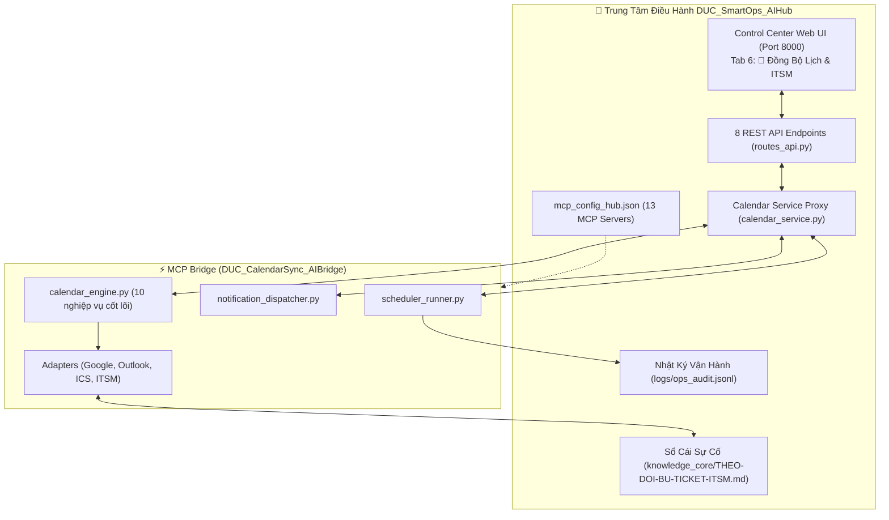

# 🌐 BÁO CÁO CHI TIẾT: LIÊN THÔNG HỆ SINH THÁI DUC_SmartOps_AIHub & WEB UI TAB 6

> **Dự án:** `DUC_CalendarSync_AIBridge` (v1.2.0 → v1.4.0)  
> **Chuyên đề:** Liên Thông Toàn Diện Với Trung Tâm Điều Hành `DUC_SmartOps_AIHub` & Giao Diện Control Center Web UI  
> **Tác giả:** Nguyễn Duy Đức (`DucWorker97` — `ducworker97@users.noreply.github.com`)  
> **Hệ sinh thái:** `DUC_SmartOps_AIHub`  
> **Ngày hoàn thành:** 09/11/2026  

---

## 1. Bối Cảnh & Kiến Trúc Tích Hợp

`DUC_SmartOps_AIHub` là trung tâm điều hành vận hành thông minh (Smart Operations AI Hub) cho kỹ sư IT/MES trong nhà máy sản xuất. Để tránh việc các MCP Bridge hoạt động đơn lẻ, `DUC_CalendarSync_AIBridge` được thiết kế để **liên thông hai chiều** với toàn bộ hệ thống:

---

## 2. Lớp Dịch Vụ Cầu Nối: `calendar_service.py`

Đặt tại `D:\DucWorker\DUC_SmartOps_AIHub\app_engine\calendar_sync\calendar_service.py`, module này đóng vai trò Facade trung gian:
- Tự động phát hiện và import module từ `mcp_bridges/DUC_CalendarSync_AIBridge/src/` thông qua điều chỉnh `sys.path` an toàn.
- Cung cấp các hàm dịch vụ chuẩn hóa:
  - `get_calendar_status()`: Lấy trạng thái kết nối Google, Outlook, tệp ICS và sổ cái ITSM.
  - `sync_all_calendars(dry_run)`: Kích hoạt đồng bộ 3 nền tảng.
  - `create_calendar_event(...)`: Tạo sự kiện tùy chỉnh.
  - `update_calendar_event(...)`: Cập nhật / dời lịch sự kiện.
  - `delete_calendar_event(event_id, dry_run)`: Xóa sự kiện an toàn (bảo vệ lịch hệ thống).
  - `generate_daily_briefing(shift_mode, include_live_sources)`: Tạo bản tin ca.
  - `get_scheduled_tasks_status()`: Đọc trạng thái Windows Task Scheduler.
  - `register_scheduled_tasks()` & `unregister_scheduled_tasks()`: Đăng ký / hủy tác vụ hệ thống.
  - `get_notification_config()`: Đọc cấu hình WeChat và Zalo.
  - `dispatch_calendar_notifications(shift_type, channels, dry_run)`: Bắn tin tức thì đa kênh.

---

## 3. Danh Mục 8 REST API Endpoints Trong `routes_api.py`

Toàn bộ các chức năng của Calendar Bridge được phơi bày qua giao diện REST API chuẩn FastAPI:

| Phương Thức | Đường Dẫn Endpoint | Mô Tả & Chức Năng |
|:---:|---|---|
| `GET` | `/api/calendar/status` | Trả về JSON tổng quan kết nối Google Calendar, Outlook Desktop MAPI, kho `.ics` và số đơn Bxx. |
| `POST` | `/api/calendar/sync` | Kích hoạt đồng bộ tức thì các sự kiện lên cả 3 nền tảng (nhận body `{"dry_run": false}`). |
| `POST` | `/api/calendar/events` | Tạo sự kiện mới tức thì với tiêu đề, khung giờ, chu kỳ lặp và nhắc hẹn. |
| `PUT` | `/api/calendar/events/{event_id}` | Dời lịch hoặc cập nhật thông tin sự kiện tùy chỉnh theo `event_id`. |
| `DELETE` | `/api/calendar/events/{event_id}` | Xóa sự kiện tùy chỉnh (chặn xóa 3 chuỗi lịch vận hành cốt lõi). |
| `GET` | `/api/calendar/briefing` | Sinh bản tin lịch trình ca sáng hoặc chiều định dạng Markdown chuẩn. |
| `GET` | `/api/calendar/notifications/config` | Lấy cấu hình kênh bắn tin (WeChat Webhook URL, nhóm chat Zalo mặc định). |
| `POST` | `/api/calendar/notifications/dispatch` | Kích hoạt định dạng và bắn bản tin ca qua WeChat Work Webhook và Zalo. |

---

## 4. Giao Diện Người Dùng Control Center Web UI: Tab 6

Tại [http://127.0.0.1:8000](http://127.0.0.1:8000), **Tab 6: 📅 Đồng Bộ Lịch & ITSM** được xây dựng hoàn chỉnh với 5 phân khu chức năng trực quan:

### 1. Thẻ Tổng Quan & Trạng Thái 3 Nền Tảng (Status Card)
- Hiển thị tình trạng kết nối thời gian thực:
  - Google Calendar OAuth CLI: `DIRECT_OAUTH_SYNC` (kèm phiên bản CLI).
  - Microsoft Outlook Desktop COM: Thư mục `Lịch` (số lượng sự kiện đã ghim).
  - Kho Lưu trữ RFC 5545: Danh sách file `.ics` và chữ ký xác thực MD5.
  - Sổ cái Sự cố ITSM: Số lượng Candidate `Bxx` cần bù đơn.
- Nút bấm **`⚡ Đồng Bộ Ngay (Sync All)`** và **`🔄 Làm Mới Trạng Thái`**.

### 2. Danh Sách Lịch Trình Quản Lý & 1-Click Deep Links
- Liệt kê đầy đủ 3 chuỗi lịch vận hành chuẩn và các lịch tùy chỉnh:
  - `DAILY_BACKUP_1745` (17:45 Thứ 2 – Thứ 7)
  - `WEEKLY_REPORT_SUN_1500` (15:00 Chủ Nhật)
  - `MONTHLY_ITSM_28_1600` (16:00 Ngày 28 hàng tháng)
- Mỗi sự kiện đều có các nút 1-Click:
  - **`🌐 Mở Google Calendar`**: Mở trực tiếp Web UI của Google Calendar với thông tin sự kiện đã điền sẵn.
  - **`📧 Mở Outlook Web`**: Deep-link mở trình soạn thảo sự kiện trên Outlook Web.
  - **`📥 Tải File .ICS`**: Tải tệp lịch chuẩn RFC 5545 để import vào bất kỳ ứng dụng nào.

### 3. Công Cụ Kiểm Tra Xung Đột Lịch Họp (Free-Busy Finder)
- Cho phép người dùng nhập thời gian dự kiến và thời lượng cuộc họp.
- Tự động kiểm tra xung đột với toàn bộ lịch hiện có.
- Nếu bị trùng, hệ thống tự động tính toán và đề xuất **3 khung giờ trống gần nhất trong giờ hành chính (08:00 - 17:30)**.

### 4. Trình Sinh Bản Tin Ca & Quét ITSM
- Hỗ trợ chọn nhanh: Bản tin Đầu ca Sáng (`08:00`) hoặc Cuối ca Chiều (`17:15`).
- Tự động quét sổ cái `THEO-DOI-BU-TICKET-ITSM.md`.
- Trình bày bản tin Markdown đẹp mắt ngay trong khung xem trước kèm nút Copy.

### 5. Thẻ Điều Khiển Bắn Thông Báo Đa Kênh Tức Thì (WeChat & Zalo)
- Chọn ca phát hành và kênh gửi.
- Hỗ trợ chế độ **`🔍 Xem Trước Định Dạng (Dry-Run)`** an toàn hiển thị chi tiết số byte, cấu hình và nội dung đã format cho WeChat/Zalo.
- Nút **`🚀 Bắn Tin Tức Thì`** với hộp thoại xác thực an toàn.

### 6. Thẻ Quản Trị Windows Task Scheduler
- Hiển thị tình trạng đăng ký 2 tác vụ chạy ngầm trên hệ điều hành (`Morning_Briefing_0800` và `Evening_Briefing_ITSM_1715`).
- Nút bấm **`⚙️ Đăng Ký Task Scheduler`** và **`🗑️ Hủy Đăng Ký`** trực tiếp từ trình duyệt mà không cần mở PowerShell.

---

## 5. Tuân Thủ Nghiêm Ngặt Các Quy Tắc Nghiệp Vụ Cốt Lõi

1. **Quy tắc 2 & Quy tắc 4 (ITSM Smart Reminder):**
   - Mọi sự cố chờ bù đơn (`Bxx`) trong `THEO-DOI-BU-TICKET-ITSM.md` khi phát hiện thiếu Mã nhân viên (`V0xxxx`) hoặc chưa có mã `INC...`, hệ thống tự động tạo sự kiện nhắc việc đính kèm câu hỏi song ngữ chuẩn:
     > *"Xin vui lòng cung cấp Mã số nhân viên (工号 - V0xxxx / 6 chữ số) của người báo sự cố để bộ phận IT hoàn tất thủ tục mở và đóng đơn ITSM theo quy định."*
2. **Quy tắc 11 (Báo Cáo Tuần MES):**
   - Lịch nhắc `WEEKLY_REPORT_SUN_1500` luôn nhắc nhở kiểm toán 9 lớp, tiêu đề nằm trên bảng metadata, font `Microsoft YaHei`, xuất PDF qua Word COM và tạo thư nháp Outlook chờ duyệt 4D.
3. **Quy tắc 12 (Bảo Toàn Dữ Liệu 100%):**
   - Lịch nhắc `DAILY_BACKUP_1745` theo dõi sao lưu Kho Nóng (Snapshot ZIP + MD5) và Kho Lạnh (Video H.265) trước khi hết giờ làm việc.

---

## 6. Ma Trận Kiểm Thử Tự Động Web UI (20/20 PASS)

Tập tin `app_engine/web_ui/test_web_ui.py` kiểm định toàn diện 20 ca kiểm thử bao phủ toàn bộ chức năng:
- Trang chủ `/` render thành công và chứa đầy đủ Tab 6.
- Toàn bộ 8 API endpoints của Calendar và Notifications phản hồi HTTP 200 với định dạng JSON hợp lệ.
- Xử lý mượt mà cả trường hợp Dry-run và Live sync.

---
*Báo cáo được lập tự động bởi trợ lý AI Antigravity — Hệ sinh thái DUC_SmartOps_AIHub.*
