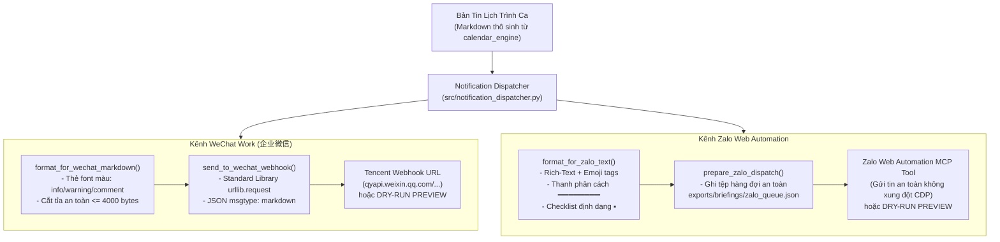

# 📲 BÁO CÁO CHI TIẾT: TÍCH HỢP THÔNG BÁO TỨC THÌ ĐA KÊNH (WECHAT WORK & ZALO)

> **Dự án:** `DUC_CalendarSync_AIBridge` (v1.4.0)  
> **Chuyên đề:** Điều phối Bản tin Lịch trình & Cảnh báo Sự cố ITSM qua WeChat Work Group Bot Webhook và Zalo Web Automation  
> **Tác giả:** Nguyễn Duy Đức (`DucWorker97` — `ducworker97@users.noreply.github.com`)  
> **Hệ sinh thái:** `DUC_SmartOps_AIHub`  
> **Ngày hoàn thành:** 09/11/2026  

---

## 1. Mục Tiêu & Yêu Cầu Nghiệp Vụ

Trong ca trực hỗ trợ hệ thống IT/MES của nhà máy, thông tin lịch trình và cảnh báo sự cố cần được truyền đạt tức thời đến các kỹ sư và quản lý trực ca qua hai kênh giao tiếp phổ biến nhất trong nhà máy:
1. **WeChat Work (企业微信 - Doanh Nghiệp WeChat):** Kênh trao đổi chính thức giữa chuyên gia hỗ trợ kỹ thuật Trung Quốc và kỹ sư MES Việt Nam.
2. **Zalo:** Kênh trao đổi nội bộ, thông báo nhanh các vấn đề hiện trường cho các nhóm vận hành Việt Nam.

**Yêu cầu kỹ thuật cốt lõi:**
- **Định dạng tối ưu theo từng kênh:** WeChat hỗ trợ markdown thẻ màu đặc thù; Zalo yêu cầu rich-text rõ ràng, emoji trực quan.
- **Giới hạn an toàn payload:** Tencent WeChat Webhook từ chối tin nhắn $> 4096$ bytes, đòi hỏi thuật toán cắt ngắn an toàn.
- **Giải quyết triệt để xung đột tài nguyên:** Ứng dụng Zalo Web Automation đang mở giữ khóa hồ sơ Chrome CDP (`ProcessSingleton`), do đó tiến trình nền của Scheduler không thể mở đồng thời browser profile thứ hai.
- **Bảo đảm an toàn 100% (Zero Accidental Dispatch):** Luôn mặc định ở chế độ Dry-Run (xem trước), chỉ bắn thật khi có xác nhận tường minh.

---

## 2. Kiến Trúc Module `src/notification_dispatcher.py`



---

## 3. Đặc Tả Định Dạng & Thuật Toán Xử Lý

### A. Kênh WeChat Work Group Bot Webhook
- **Thẻ màu chuyên dụng:**
  - `<font color="info">`: Màu xanh lá cây/xanh biển nhạt. Dùng cho: số lượng sự kiện, trạng thái `ALL CLEAR (0 tồn đọng)`, hoàn tất 100%.
  - `<font color="warning">`: Màu cam/vàng. Dùng cho: sự cố chờ bù đơn `Bxx`, thiếu Mã nhân viên `V0xxxx`.
  - `<font color="comment">`: Màu xám. Dùng cho: ngày làm việc, phân loại sự kiện `smartops_managed`, metadata.
- **Thuật toán cắt ngắn an toàn ($\le 4000$ bytes):**
  ```python
  encoded = content.encode("utf-8")
  if len(encoded) > max_bytes:
      truncated = encoded[:max_bytes - 120].decode("utf-8", errors="ignore")
      content = truncated + "\n\n> <font color=\"comment\">...[Bản tin được cắt gọn do giới hạn 4096 bytes của WeChat]...</font>"
  ```
- **Payload chuẩn Tencent JSON-RPC HTTP POST:**
  ```json
  {
    "msgtype": "markdown",
    "markdown": {
      "content": "### 🌅 BẢN TIN ĐẦU CA SÁNG (08:00 — MORNING BRIEFING)\n..."
    }
  }
  ```

### B. Kênh Zalo Web Automation & Giải Quyết Xung Đột CDP
- **Đặc điểm Rich-Text:**
  - Header: `📌 🌅 BẢN TIN ĐẦU CA SÁNG (08:00 — MORNING BRIEFING)`
  - Thanh phân cách: `══════════════════════════`
  - Checklist: Dùng ký tự đặc biệt `▪️` và số thứ tự `1. [17:45] ...`
- **Giải quyết bài toán Chrome CDP Singleton:**
  - Khi `Zalo-Web-Automation` MCP Server đang chạy, profile Chrome tại `.browser_profile` bị khóa bởi Windows process singleton.
  - Module `notification_dispatcher.py` áp dụng giải pháp **Hàng Đợi File Độc Lập (`zalo_queue.json`)**:
    - Tin nhắn được xếp vào hàng đợi kèm timestamp, chat mục tiêu (`target_chat: "Thông báo chung OLAZ"`), và trạng thái `PENDING`.
    - Trợ lý AI hoặc MCP server `Zalo-Web-Automation` chỉ cần đọc hàng đợi và gọi công cụ `zalo_send_message` trực tiếp trong phiên đang hoạt động mà không bao giờ gây va chạm tiến trình.

---

## 4. MCP Tool Thứ 11: `cal_dispatch_notification`

Trong `server.py`, công cụ được đăng ký với các tham số:

```python
def cal_dispatch_notification(
    shift_mode: str = "AUTO",
    channels: list = None,
    dry_run: bool = True,
    confirm_send: bool = False
) -> Dict[str, Any]:
    """
    Định dạng và bắn Bản tin Lịch trình tức thì qua WeChat Work Webhook và Zalo.
    - shift_mode: 'AUTO', 'MORNING' (08:00), 'EVENING' (17:15).
    - channels: Danh sách kênh ['wechat', 'zalo'] (mặc định cả hai).
    - dry_run: True = chỉ xem trước nội dung format và số byte/ký tự.
    - confirm_send: True = kích hoạt gửi thật ra ngoài.
    """
```

**Ví dụ phản hồi xem trước (Dry-Run Preview):**
```json
{
  "status": "SUCCESS",
  "action": "DISPATCH_DAILY_BRIEFING",
  "dry_run": true,
  "channels": {
    "wechat": {
      "status": "NOT_CONFIGURED",
      "channel": "wechat_work_webhook",
      "content_bytes": 991,
      "preview_content": "### 🌆 BẢN TIN CUỐI CA CHIỀU (17:15 — EVENING BRIEFING)\n> **Ngày làm việc:** <font color=\"comment\">2026-11-09</font>\n..."
    },
    "zalo": {
      "status": "PREVIEW_READY",
      "channel": "zalo_web_automation",
      "target_chat": "Thông báo chung OLAZ",
      "char_count": 768,
      "queue_file": "exports/briefings/zalo_queue.json"
    }
  }
}
```

---

## 5. Tích Hợp Web UI Tab 6 (`http://127.0.0.1:8000`)

Trên giao diện Control Center, một thẻ điều khiển mới đã được bổ sung:
- **Card:** `📲 Bắn Bản Tin Tức Thì Đa Kênh (WeChat Work Webhook & Zalo)`
- **Các bộ chọn tương tác:**
  - Radio button: Ca Sáng (`MORNING`) / Ca Chiều (`EVENING`)
  - Checkboxes: Kênh WeChat Work Webhook / Kênh Zalo Web Automation
- **2 Chế độ kích hoạt:**
  - **Nút "🔍 Xem Trước Định Dạng (Dry-Run)":** Gửi request tới `POST /api/calendar/notifications/dispatch` với `dry_run=true`. Hiển thị hộp thông báo kết quả gồm đoạn văn bản mẫu cho cả hai kênh, dung lượng byte và cảnh báo cấu hình.
  - **Nút "🚀 Bắn Tin Tức Thì":** Hiển thị hộp thoại xác nhận an toàn trước khi gửi thật (`dry_run=false`).

---

## 6. Kết Quả Kiểm Thử & Xác Minh

1. **Unit Test (`tests/test_calendar_mcp.py`):**
   - Bài test `test_notification_dispatcher_formats_and_dryrun` xác minh 100% logic:
     - Thẻ màu `<font color="info">` và `<font color="warning">` sinh chính xác.
     - Ký tự phân cách `════════` và checklist `▪️` của Zalo sinh chuẩn.
     - Chế độ Dry-Run không thực hiện HTTP POST ngoài ý muốn.
2. **Integration Test Web UI (`app_engine/web_ui/test_web_ui.py`):**
   - Bài test `test_api_calendar_notification_endpoints` xác minh:
     - `GET /api/calendar/notifications/config` trả HTTP 200 kèm cấu hình mặc định.
     - `POST /api/calendar/notifications/dispatch` trả HTTP 200 kèm `status: SUCCESS` và kết quả preview cho cả hai kênh.
3. **Chạy thử nghiệm CLI thành công:**
   ```bash
   python -m src.scheduler_runner --mode MORNING --dispatch
   ```

---
*Báo cáo được lập tự động bởi trợ lý AI Antigravity — Hệ sinh thái DUC_SmartOps_AIHub.*
