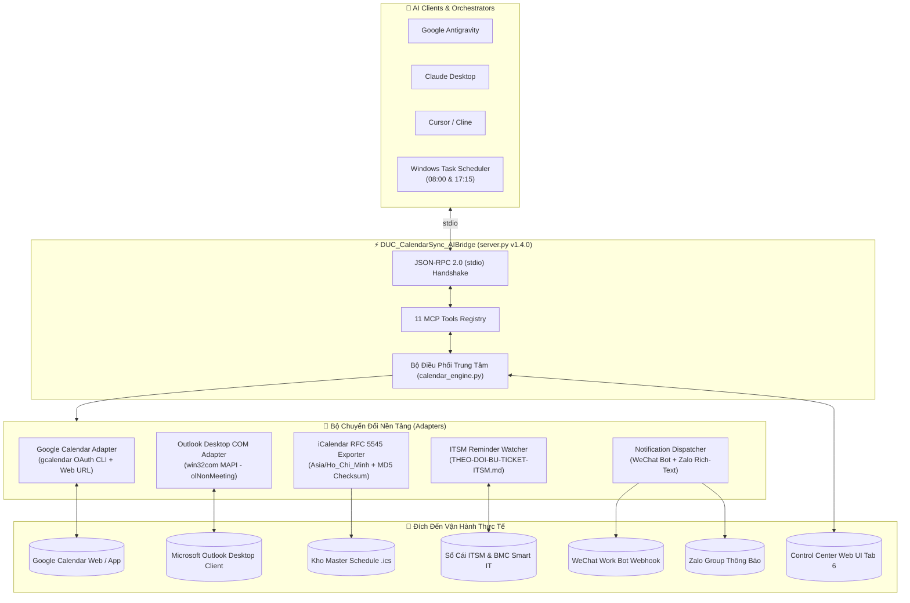

# 📅 BÁO CÁO TỔNG KẾT TOÀN DIỆN DỰ ÁN DUC_CalendarSync_AIBridge (v1.0.0 → v1.4.0)

> **Dự án:** `DUC_CalendarSync_AIBridge`  
> **Phiên bản:** `v1.4.0` (Production Ready)  
> **Tác giả:** Nguyễn Duy Đức (`DucWorker97` — `ducworker97@users.noreply.github.com`)  
> **Hệ sinh thái:** `DUC_SmartOps_AIHub`  
> **Thời điểm lập báo cáo:** 09/11/2026  
> **Trạng thái:** ✅ Đã hoàn tất 100%, 10/10 Pytest PASS, 20/20 Hub Web UI PASS, đã đồng bộ GitHub `DucWorker97`.

---

## 📑 MỤC LỤC BÁO CÁO

1. [Tầm Nhìn & Bối Cảnh Nghiệp Vụ](#1-tầm-nhìn--bối-cảnh-nghiệp-vụ)
2. [Lịch Sử Tiến Hóa Qua 7 Phiên Phát Triển (Changelog Chi Tiết)](#2-lịch-sử-tiến-hóa-qua-7-phiên-phát-triển)
3. [Kiến Trúc Kỹ Thuật Tổng Thể (System Architecture)](#3-kiến-trúc-kỹ-thuật-tổng-thể)
4. [Danh Mục 11 MCP Tools Chuẩn stdio JSON-RPC 2.0](#4-danh-mục-11-mcp-tools-chuẩn-stdio-json-rpc-20)
5. [3 Chuỗi Lịch Vận Hành Cốt Lõi & Tuân Thủ Quy Tắc Nhà Máy](#5-3-chuỗi-lịch-vận-hành-cốt-lõi--tuân-thủ-quy-tắc-nhà-máy)
6. [3 Nền Tảng Đồng Bộ Lịch Thực Tế 2 Chiều](#6-3-nền-tảng-đồng-bộ-lịch-thực-tế-2-chiều)
7. [Hệ Thống Tự Động Hóa Kép (Task Scheduler & Sidecars)](#7-hệ-thống-tự-động-hóa-kép)
8. [Hệ Thống Bắn Thông Báo Tức Thì Đa Kênh (WeChat Work & Zalo)](#8-hệ-thống-bắn-thông-báo-tức-thì-đa-kênh)
9. [Liên Thông Toàn Diện Với DUC_SmartOps_AIHub & Web UI Tab 6](#9-liên-thông-toàn-diện-với-duc_smartops_aihub--web-ui-tab-6)
10. [Ma Trận Kiểm Thử Tự Động & An Toàn Bảo Mật](#10-ma-trận-kiểm-thử-tự-động--an-toàn-bảo-mật)
11. [Hướng Dẫn Vận Hành & Khởi Chạy Nhanh](#11-hướng-dẫn-vận-hành--khởi-chạy-nhanh)

---

## 1. Tầm Nhìn & Bối Cảnh Nghiệp Vụ

Trong môi trường vận hành công nghiệp và hỗ trợ hệ thống IT/MES của nhà máy sản xuất, kỹ sư vận hành phải đối mặt với các thách thức lớn:
- **Lịch trình phân tán:** Lịch công tác, bảo trì, ca trực nằm rải rác trên Google Calendar, Microsoft Outlook Desktop của công ty và các ghi chú cá nhân.
- **Sự cố tồn đọng (ITSM Backlog):** Các sự cố xử lý nhanh tại hiện trường (mã `Bxx`) chưa kịp tạo đơn trên BMC Remedy Smart IT hoặc bị thiếu thông tin mã nhân viên người yêu cầu (`V0xxxx`).
- **Nghĩa vụ báo cáo & sao lưu đúng hạn:** Nguy cơ quên mốc 17:45 kích hoạt sao lưu Kho Nóng / Kho Lạnh (Quy tắc 12) hoặc quên mốc 15:00 Chủ Nhật kiểm toán 9 lớp Báo cáo tuần MES (Quy tắc 11).

**`DUC_CalendarSync_AIBridge`** ra đời nhằm giải quyết triệt để các bài toán trên bằng cách cung cấp một **MCP Server đa nền tảng** hoạt động như một "trạm điều phối không lưu" tự động hóa toàn bộ việc đồng bộ lịch, quét sự cố, phát hiện xung đột, xuất bản tin ca và bắn thông báo tức thì tới các nhóm chat vận hành.

---

## 2. Lịch Sử Tiến Hóa Qua 7 Phiên Phát Triển

| Phiên (Session) | Ngày | Trọng tâm Triển khai | Kết quả Đạt được |
|:---:|:---:|---|---|
| **Session 1** | 09/11/2026 | Khởi tạo nền tảng v1.0.0 | Xây dựng 5 MCP tools đầu tiên (`cal_status`, `cal_sync_all`, `cal_create_event`, `cal_remind_pending_itsm`, `cal_list_events`), 3 adapter (Google Calendar CLI, Outlook MAPI COM, RFC 5545 ICS) và ITSM reminder watcher. |
| **Session 2** | 09/11/2026 | Chuẩn bị Bàn giao (Handoff) | Tối ưu kết nối `GetActiveObject("Outlook.Application")`, tương thích kép FastMCP & MCPServer, tài liệu bàn giao `HANDOFF-MACHINE-TRANSFER.md` và cấp quyền Collaborator cho `DucWorker19`. |
| **Session 3** | 09/11/2026 | Nâng cấp v1.2.0 | Bổ sung 5 MCP tools (`cal_delete_event`, `cal_query_schedule`, `cal_check_conflicts`, `cal_update_event`, `cal_daily_briefing`), hỗ trợ cờ `--register-mcp`, đạt 7/7 Pytest PASS. |
| **Session 4** | 09/11/2026 | Chuẩn hóa Portfolio GitHub | Thiết lập GitHub Actions CI Matrix (`.github/workflows/ci.yml` - Windows & Ubuntu, Python 3.10-3.12), bổ sung giấy phép MIT `LICENSE`, tái cấu trúc `README.md` chuẩn Showcase với huy hiệu động và sơ đồ Mermaid. |
| **Session 5** | 09/11/2026 | Liên thông Hub & Web UI | Đăng ký MCP Server vào `mcp_config_hub.json`, tích hợp `calendar_service.py`, mở rộng 6 REST API endpoints, dựng Tab 6 `📅 Đồng Bộ Lịch & ITSM` trên Control Center Web UI, 18/18 Web UI tests PASS. |
| **Session 6** | 09/11/2026 | Tự động hóa ca & v1.3.0 | Xây dựng module `scheduler_runner.py` chạy ngầm qua Windows Task Scheduler (`pythonw.exe`), bộ script PowerShell/Batch quản trị, 2 Antigravity Sidecar Automations, nâng lên 9/9 Bridge Pytest PASS và 19/19 Hub Web UI tests PASS. |
| **Session 7** | 09/11/2026 | Bắn tin Đa kênh & v1.4.0 | Xây dựng `notification_dispatcher.py` bắn tin WeChat Work Webhook (thẻ màu `<font>`) & Zalo Web Automation (hàng đợi chống khóa CDP), thêm MCP Tool thứ 11 `cal_dispatch_notification`, điều khiển từ Web UI Tab 6, nâng lên 10/10 Bridge Pytest PASS và 20/20 Hub Web UI tests PASS. |

---

## 3. Kiến Trúc Kỹ Thuật Tổng Thể



---

## 4. Danh Mục 11 MCP Tools Chuẩn stdio JSON-RPC 2.0

| STT | Tên Công Cụ (Tool) | Tham Số Đầu Vào | Chức Năng Chính | Bảo Mật & Idempotency |
|:---:|---|---|---|---|
| 1 | `cal_status` | *Không* | Báo cáo tình trạng kết nối Google OAuth, Outlook MAPI, kho `.ics` và số đơn Bxx. | Read-only |
| 2 | `cal_sync_all` | `dry_run: bool` | Đồng bộ 3 chuỗi lịch chuẩn và lịch tùy chỉnh lên cả 3 nền tảng. | Thẻ `[SMARTOPS-ID:...]` chống trùng |
| 3 | `cal_create_event` | `title`, `start_iso`, `duration_minutes`, `description`, `location`, `recurrence_type`, `reminder_minutes`, `dry_run` | Tạo sự kiện mới tức thì với chu kỳ lặp và nhắc hẹn tự động. | Kiểm tra trùng lặp trước khi ghi |
| 4 | `cal_remind_pending_itsm` | `candidate_id`, `customer_name`, `issue_summary`, `reminder_iso`, `dry_run` | Quét sổ cái ITSM hoặc nhận Candidate Bxx để tạo lịch nhắc bù đơn. | Tự đính kèm mẫu câu hỏi Mã NV VI-ZH |
| 5 | `cal_list_events` | *Không* | Trích xuất toàn bộ lịch trình kèm 1-Click Deep Links (Google & Outlook Web). | Read-only |
| 6 | `cal_delete_event` | `event_id`, `dry_run: bool` | Xóa sự kiện tùy chỉnh đồng bộ trên kho `.ics`, Outlook và Google. | Khóa `PROTECTED_SYSTEM_EVENT` |
| 7 | `cal_query_schedule` | `date_from_iso`, `days: int`, `include_live_sources: bool` | Đọc lịch trình 2 chiều thực tế từ nhiều nguồn và hợp nhất theo timeline. | Read-only |
| 8 | `cal_check_conflicts` | `start_iso`, `duration_minutes: int`, `include_live_sources: bool` | Kiểm tra xung đột lịch và tự động gợi ý 3 khung giờ trống hành chính gần nhất. | Read-only (Free-Busy Finder) |
| 9 | `cal_update_event` | `event_id`, `new_title`, `new_start_iso`, `new_duration_minutes`, `new_description`, `new_location`, `new_recurrence_type`, `new_reminder_minutes`, `dry_run` | Dời lịch (reschedule) hoặc cập nhật tiêu đề, mô tả, địa điểm theo ID. | Bảo vệ sự kiện hệ thống cốt lõi |
| 10 | `cal_daily_briefing` | `date_iso`, `shift_mode: str`, `include_live_sources: bool` | Sinh Bản tin Lịch trình Đầu ca (`08:00`) hoặc Cuối ca (`17:15`) kèm Checklist. | Xuất Markdown chuẩn |
| 11 | `cal_dispatch_notification` | `shift_mode: str`, `channels: list`, `dry_run: bool`, `confirm_send: bool` | Định dạng và bắn Bản tin Lịch trình tức thì qua WeChat Work & Zalo. | Mặc định Dry-Run an toàn |

---

## 5. 3 Chuỗi Lịch Vận Hành Cốt Lõi & Tuân Thủ Quy Tắc Nhà Máy

Hệ thống thiết lập sẵn 3 chuỗi lịch đóng vai trò "xương sống" cho toàn bộ ca trực:

1. **`DAILY_BACKUP_1745` (17:45 Thứ 2 – Thứ 7):**
   - **Mục tiêu:** Kích hoạt sao lưu Kho Nóng (Snapshot ZIP + MD5) và Kho Lạnh (Video H.265) & Chưng cất Hòm thư.
   - **Quy tắc:** Tuân thủ nghiêm ngặt **Quy tắc 12 (Bảo toàn 100% dữ liệu)**.
   - **Chu kỳ lặp:** `RRULE:FREQ=WEEKLY;BYDAY=MO,TU,WE,TH,FR,SA`.

2. **`WEEKLY_REPORT_SUN_1500` (15:00 Chủ Nhật hàng tuần):**
   - **Mục tiêu:** Biên soạn & Kiểm toán 9 Lớp Báo cáo Tuần MES Song ngữ (VI–ZH).
   - **Quy tắc:** Tuân thủ **Quy tắc 11** (tiêu đề nằm trên bảng, font Microsoft YaHei, xuất PDF qua Word COM và tạo thư nháp Outlook chờ duyệt 4D).
   - **Chu kỳ lặp:** `RRULE:FREQ=WEEKLY;BYDAY=SU`.

3. **`MONTHLY_ITSM_28_1600` (16:00 Ngày 28 hàng tháng):**
   - **Mục tiêu:** Rà soát Sổ cái Sự cố & Khóa sổ Bù đơn Ticket ITSM Tháng.
   - **Quy tắc:** Đảm bảo 100% Candidate `Bxx` được đối soát Customer và đóng hoàn tất trên BMC Smart IT (Quy tắc 2, 4, 8, 9).
   - **Chu kỳ lặp:** `RRULE:FREQ=MONTHLY;BYMONTHDAY=28`.

---

## 6. 3 Nền Tảng Đồng Bộ Lịch Thực Tế 2 Chiều

1. **Google Calendar Adapter (`src/gcalendar_adapter.py`):**
   - Tương tác qua `gcalendar` OAuth CLI (`cl/986250228`).
   - Sử dụng cờ `--send-updates none` triệt để nhằm **không gửi email làm phiền đối tác ngoài** (Zero External Spam).
   - Tự động sinh Google Calendar Web URL 1-Click kèm `recur=RRULE:...` và `ctz=Asia/Ho_Chi_Minh`.
2. **Microsoft Outlook Desktop Adapter (`src/outlook_adapter.py`):**
   - Tương tác trực tiếp qua MAPI COM (`win32com.client`).
   - Ưu tiên cơ chế `GetActiveObject("Outlook.Application")` và tự fallback sang `Dispatch` để tránh treo tiến trình nền `OUTLOOK.EXE`.
   - Luôn thiết lập `appt.MeetingStatus = 0` (`olNonMeeting`) và không thêm `Recipients`.
   - Tạo Deep-Link Outlook Web `https://outlook.office.com/calendar/0/deeplink/compose?...`.
3. **iCalendar RFC 5545 Exporter (`src/ics_exporter.py`):**
   - Định dạng chuẩn quốc tế tương thích Apple Calendar, Google Calendar, Thunderbird và Outlook.
   - Tích hợp khối múi giờ chuẩn `VTIMEZONE (Asia/Ho_Chi_Minh)`, chuông báo nhắc hẹn `VALARM` trước 10-15 phút.
   - Tự động tính toán mã băm `MD5 Checksum` để bảo đảm tính toàn vẹn của tệp lịch tổng `DUC_SmartOps_Master_Schedule.ics`.

---

## 7. Hệ Thống Tự Động Hóa Kép

Hệ thống kết hợp cơ chế tự động hóa 2 tầng giúp vận hành liên tục 24/7:

1. **Tầng 1 — Windows Task Scheduler (Cấp Hệ Điều Hành):**
   - Sử dụng `pythonw.exe` để chạy ngầm 100% không làm bật cửa sổ CMD đen gây phiền toái.
   - Tác vụ 1: `DUC_SmartOps\Morning_Briefing_0800` (08:00 Thứ 2 – Thứ 7) $\rightarrow$ Sinh bản tin đầu ca sáng.
   - Tác vụ 2: `DUC_SmartOps\Evening_Briefing_ITSM_1715` (17:15 Thứ 2 – Thứ 7) $\rightarrow$ Quét sổ cái ITSM, nhắc bù đơn và cảnh báo mốc sao lưu 17:45.
   - Quản trị dễ dàng qua bộ script 1-Click trong thư mục `scripts/` hoặc qua cờ `--register-tasks`, `--unregister-tasks`, `--status-tasks`.
2. **Tầng 2 — Antigravity Scheduled Automations (Cấp AI Assistant):**
   - 2 Scheduled Sidecars cấu hình tại `~/.gemini/config/sidecars/`:
     - `smartops-morning-briefing`: Kích hoạt định kỳ `CRON_TZ=Asia/Ho_Chi_Minh 0 8 * * 1-6`.
     - `smartops-evening-briefing`: Kích hoạt định kỳ `CRON_TZ=Asia/Ho_Chi_Minh 15 17 * * 1-6`.

---

## 8. Hệ Thống Bắn Thông Báo Tức Thì Đa Kênh

Triển khai tại `src/notification_dispatcher.py` và tích hợp vào `server.py`:

- **WeChat Work Group Bot Webhook (企业微信):**
  - Sử dụng định dạng màu phong phú:
    - `<font color="info">`: Hiển thị số lượng sự kiện, trạng thái ALL CLEAR.
    - `<font color="warning">`: Cảnh báo khi có đơn Bxx chưa bù hoặc thiếu Mã NV.
    - `<font color="comment">`: Hiển thị ngày tháng, nguồn dữ liệu và mã ID.
  - Tự động giới hạn an toàn $\le 4000$ bytes tránh lỗi từ chối của Tencent API.
- **Zalo Web Automation:**
  - Định dạng Rich-Text với header, separator `════════` và checklist công việc.
  - Hàng đợi an toàn `exports/briefings/zalo_queue.json` hỗ trợ dispatch qua nhóm mà không xung đột trình duyệt CDP.
- **Chế độ Dry-Run An Toàn:**
  - Luôn hỗ trợ xem trước (preview) nội dung format và số byte trước khi gửi thật.

---

## 9. Liên Thông Toàn Diện Với DUC_SmartOps_AIHub & Web UI Tab 6

- Đăng ký MCP Server vào `mcp_config_hub.json` của hệ sinh thái `DUC_SmartOps_AIHub`.
- Kết nối trực tiếp qua `calendar_service.py` với 8 REST API Endpoints trong `routes_api.py`:
  - `GET /api/calendar/status`
  - `POST /api/calendar/sync`
  - `POST /api/calendar/events`
  - `PUT /api/calendar/events/{event_id}`
  - `DELETE /api/calendar/events/{event_id}`
  - `GET /api/calendar/briefing`
  - `GET /api/calendar/notifications/config`
  - `POST /api/calendar/notifications/dispatch`
- **Control Center Web UI (Tab 6 — `http://127.0.0.1:8000`):**
  - Bảng điều khiển trạng thái đồng bộ 3 nền tảng.
  - Danh sách sự kiện trực quan kèm nút mở nhanh Google Calendar Web và Outlook Web.
  - Bảng kiểm tra xung đột lịch họp (Free-Busy Finder).
  - Trình sinh và xem trước Bản tin Đầu ca / Cuối ca.
  - Thẻ điều khiển Bắn thông báo tức thì đa kênh với chế độ Xem trước (Dry-Run) và Bắn thật.

---

## 10. Ma Trận Kiểm Thử Tự Động & An Toàn Bảo Mật

### A. Kết Quả Kiểm Thử (100% PASS)
- **Kiểm thử Unit & Integration Bridge (`tests/test_calendar_mcp.py`):** **10 / 10 PASS**
  1. `test_models_and_schedules_integrity`: Kiểm tra tính toàn vẹn 3 chuỗi lịch.
  2. `test_ics_export_and_md5`: Kiểm tra xuất tệp `.ics` và mã băm MD5.
  3. `test_itsm_reminder_watcher`: Kiểm tra trích xuất sổ cái ITSM.
  4. `test_calendar_engine_sync_all_dry_run`: Kiểm tra đồng bộ Idempotent.
  5. `test_calendar_engine_query_schedule`: Kiểm tra truy vấn hợp nhất.
  6. `test_calendar_engine_check_conflicts`: Kiểm tra Free-Busy Finder.
  7. `test_calendar_engine_update_event`: Kiểm tra dời lịch và cập nhật sự kiện.
  8. `test_calendar_engine_daily_briefing`: Kiểm tra sinh bản tin ca.
  9. `test_scheduler_runner_routines`: Kiểm tra trình tự động ca sáng và chiều.
  10. `test_notification_dispatcher_formats_and_dryrun`: Kiểm tra format WeChat, Zalo và Dry-run.
- **Kiểm thử Web UI Hub (`app_engine/web_ui/test_web_ui.py`):** **20 / 20 PASS** (bao gồm toàn bộ 8 API endpoints của Lịch và Thông báo).

### B. Kiểm Định Git Author & Security Guardrails
- **Git Author:** Luôn duy trì định danh `DucWorker97` (`ducworker97@users.noreply.github.com`).
- **An toàn dữ liệu:** Không lưu trữ mật khẩu, file `.env`, file credential hay tệp lịch sinh động vào kho Git.
- **Bảo vệ hệ thống:** 3 chuỗi lịch vận hành cốt lõi được bảo vệ chống xóa tùy tiện qua cờ `PROTECTED_SYSTEM_EVENT`.

---

## 11. Hướng Dẫn Vận Hành & Khởi Chạy Nhanh

### 1. Tự kiểm định nhanh MCP Server
```bash
python server.py --selftest
```

### 2. Chạy bộ kiểm thử tự động
```bash
python -m pytest tests/ -v
```

### 3. Đăng ký Windows Task Scheduler (Chạy ngầm tự động hàng ngày)
```bash
python server.py --register-tasks
# hoặc chạy 1-Click:
scripts\Register_Task_Scheduler.bat
```

### 4. Bắn thử Bản tin ca sáng qua WeChat & Zalo (Dry-Run an toàn)
```bash
python -m src.scheduler_runner --mode MORNING --dispatch
```

### 5. Truy cập Web UI Control Center
Mở trình duyệt tại [http://127.0.0.1:8000](http://127.0.0.1:8000) và chọn **Tab 6: 📅 Đồng Bộ Lịch & ITSM**.

---
*Báo cáo được lập tự động bởi trợ lý AI Antigravity — Hệ thống DUC_SmartOps_AIHub.*
