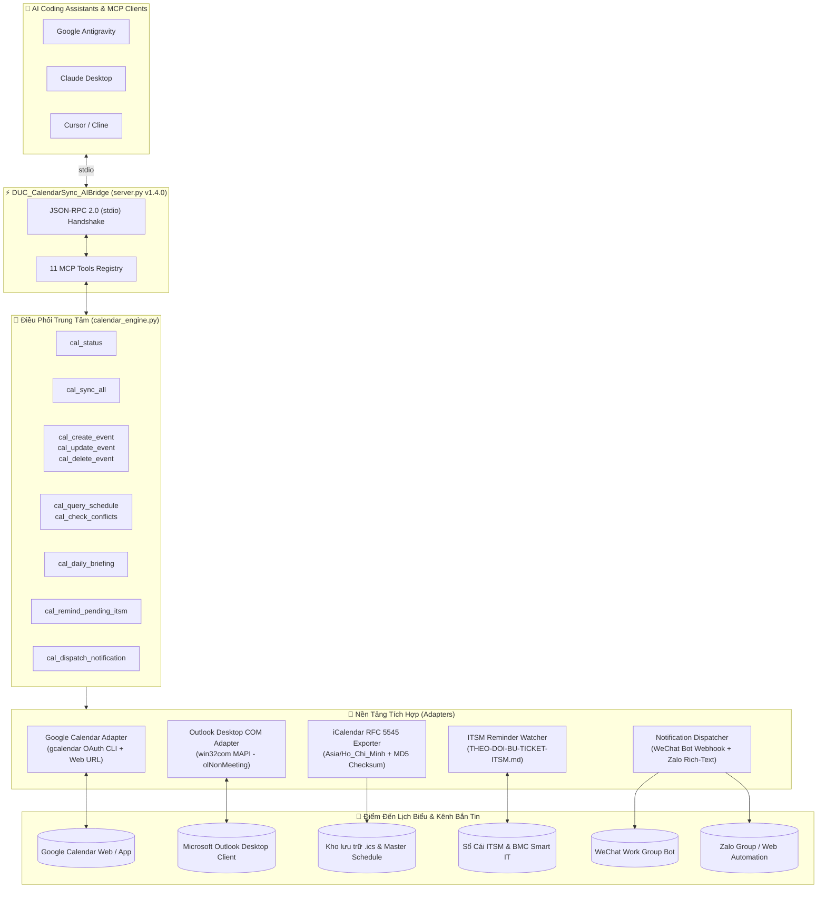

# 📅 DUC_CalendarSync_AIBridge

> **Multi-Platform Calendar Sync & ITSM Smart Reminder MCP Server**  
> *Hệ thống Cầu nối MCP Điều phối Lịch biểu Tự động Đa Nền tảng 2 Chiều & Nhắc Lịch Sự cố ITSM Thông minh (v1.4.0)*

[](https://github.com/DucWorker97/DUC_CalendarSync_AIBridge/actions/workflows/ci.yml)
[](LICENSE)
[](https://www.python.org/)
[](https://modelcontextprotocol.io)
[](tests/)
[](#)
[](#)
[](https://github.com/DucWorker97)

---

## 📖 Giới Thiệu Tổng Quan (Executive Summary)

**`DUC_CalendarSync_AIBridge`** là một **Model Context Protocol (MCP) Server** chuyên trách chuẩn `stdio` JSON-RPC 2.0, được thiết kế để kết nối trực tiếp các trợ lý AI hàng đầu (**Google Antigravity**, **Claude Desktop**, **Cursor**, **Cline**) với hệ thống quản lý lịch trình công việc thực tế trong môi trường vận hành nhà máy và bộ phận IT/MES:

1. **Đồng Bộ Lịch Đa Nền Tảng 2 Chiều:** Kết nối đồng thời **Google Calendar** (OAuth CLI & 1-Click Web URL kèm `RRULE`), **Microsoft Outlook Desktop** (MAPI COM tự động ghim lịch vào thư mục `Lịch`), và **Chuẩn Quốc tế iCalendar RFC 5545** (`.ics` kèm múi giờ `Asia/Ho_Chi_Minh`, chu kỳ lặp `RRULE`, chuông báo `VALARM` và chữ ký xác thực toàn vẹn `MD5`).
2. **Tự Động Nhắc Lịch Bù Đơn ITSM (`Bxx`):** Tự động quét sổ cái sự cố `THEO-DOI-BU-TICKET-ITSM.md` để phát hiện các đơn chưa hoàn tất hoặc thiếu Mã nhân viên (`V0xxxx`), tự động ghim lịch nhắc bù đơn kèm câu mẫu song ngữ VI–ZH (Quy tắc 2 & Quy tắc 4).
3. **Phát Hiện Xung Đột & Gợi Ý Khung Giờ Trống (Free-Busy Finder):** Kiểm tra trùng lịch họp trước khi đặt sự kiện và tự động đề xuất 3 khung giờ trống khả dụng trong giờ hành chính (`08:00 - 17:30`).
4. **Bản Tin Lịch Trình Đầu Ca / Cuối Ca:** Sinh báo cáo tóm tắt công việc trong ngày và checklist hành động theo ca (Sáng `08:00` / Chiều `17:15`) định dạng Markdown chuẩn đẹp.
5. **Thông Báo Tức Thì Đa Kênh (WeChat Work & Zalo):** Tự động định dạng và bắn bản tin ca qua Webhook Bot Doanh nghiệp (企业微信) và Rich-Text Zalo có hỗ trợ hàng đợi an toàn chống xung đột tiến trình.

---

## 🏗️ Sơ Đồ Kiến Trúc Hệ Thống (System Architecture)



---

## 🛠️ Danh Mục 11 MCP Tools Hoàn Chỉnh (`v1.4.0`)

| # | Tên MCP Tool | Tham số đầu vào (Parameters) | Mô tả Chức năng | Đặc điểm Kỹ thuật |
|---|---|---|---|---|
| 1 | **`cal_status`** | *Không có* | Kiểm tra trạng thái kết nối Google Calendar OAuth, Outlook Desktop MAPI, kho `.ics` và số lượng đơn `Bxx` chờ bù. | Báo cáo chi tiết đường dẫn CLI, phiên bản, tình trạng thư mục `Lịch` và số đơn tồn đọng. |
| 2 | **`cal_sync_all`** | `dry_run: bool = False` | Đồng bộ tức thì 3 chuỗi lịch vận hành chuẩn và lịch tùy chỉnh lên cả 3 nền tảng. | Idempotent chống trùng lặp qua thẻ `[SMARTOPS-ID:...]`, xuất `DUC_SmartOps_Master_Schedule.ics`. |
| 3 | **`cal_create_event`** | `title`, `start_iso`, `duration_minutes`, `description`, `location`, `recurrence_type`, `reminder_minutes`, `dry_run` | Đặt lịch sự kiện mới tức thì lên Google Calendar, Outlook Desktop và kho `.ics`. | Hỗ trợ quy tắc lặp `NONE`, `DAILY_WORKDAYS`, `WEEKLY_SUN`, `MONTHLY_28`, tự sinh URL 1-Click. |
| 4 | **`cal_remind_pending_itsm`** | `candidate_id`, `customer_name`, `issue_summary`, `reminder_iso`, `dry_run` | Quét sổ cái `THEO-DOI-BU-TICKET-ITSM.md` (hoặc nhận sự cố mới) để tự động đặt lịch nhắc bù đơn. | Đính kèm sẵn câu hỏi Mã NV (`V0xxxx`) song ngữ VI–ZH theo chuẩn Quy tắc 2 & 4. |
| 5 | **`cal_list_events`** | *Không có* | Liệt kê toàn bộ các chuỗi sự kiện đang quản lý kèm liên kết 1-Click. | Trả về liên kết sâu Google Calendar Web, Outlook Web Deep-Link và đường dẫn tệp `.ics`. |
| 6 | **`cal_delete_event`** | `event_id`, `dry_run: bool = False` | Xóa sự kiện tùy chỉnh theo `event_id` đồng bộ trên kho `.ics`, Outlook Desktop và Google Calendar. | Có cơ chế khóa bảo vệ an toàn (`PROTECTED_SYSTEM_EVENT`) cho 3 chuỗi lịch vận hành cốt lõi. |
| 7 | **`cal_query_schedule`** | `date_from_iso`, `days: int = 7`, `include_live_sources: bool = True` | Đọc lịch trình thực tế 2 chiều trong ngày/tuần từ Managed Store, Google Calendar và Outlook Desktop. | Hợp nhất sự kiện từ nhiều nguồn, sắp xếp theo thứ tự thời gian tăng dần. |
| 8 | **`cal_check_conflicts`** | `start_iso`, `duration_minutes: int = 30`, `include_live_sources: bool = False` | Kiểm tra xung đột lịch họp (Free-Busy Finder) tại khung giờ dự kiến. | Tự động tính toán và đề xuất **3 khung giờ trống gần nhất** trong giờ hành chính (`08:00 - 17:30`). |
| 9 | **`cal_update_event`** | `event_id`, `new_title`, `new_start_iso`, `new_duration_minutes`, `new_description`, `new_location`, `new_recurrence_type`, `new_reminder_minutes`, `dry_run` | Dời lịch (reschedule) hoặc cập nhật tiêu đề, thời lượng, mô tả của sự kiện theo `event_id`. | Đồng bộ cập nhật trên cả Google Calendar, Outlook Desktop, tệp `.ics` và `custom_events.json`. |
| 10 | **`cal_daily_briefing`** | `date_iso`, `shift_mode: str = 'AUTO'`, `include_live_sources: bool = False` | Sinh Bản tin Lịch trình Đầu ca (`MORNING` - 08:00) hoặc Cuối ca (`EVENING` - 17:15). | Định dạng Markdown hoàn chỉnh kèm checklist ca làm việc, sẵn sàng đẩy qua WeChat / Zalo. |
| 11 | **`cal_dispatch_notification`** | `shift_mode: str = 'AUTO'`, `channels: list = None`, `dry_run: bool = True`, `confirm_send: bool = False` | Định dạng và bắn Bản tin Lịch trình tức thì qua các kênh cộng tác (WeChat Work Webhook, Zalo Web Automation). | Hỗ trợ chuẩn Markdown thẻ màu WeChat, Rich-Text Zalo, giới hạn an toàn 4000 bytes, mặc định Dry-Run an toàn. |

---

## ⏰ 3 Chuỗi Lịch Vận Hành Tự Động Chuẩn

Hệ thống được cấu hình sẵn 3 chuỗi lịch định kỳ đóng vai trò "xương sống" cho hoạt động vận hành:

1. **`DAILY_BACKUP_1745` (17:45 Thứ 2 – Thứ 7):**
   - *Mục tiêu:* Sao lưu Đám mây Tự động (Kho Nóng Snapshot ZIP + MD5 và Kho Lạnh Video H.265) & Chưng cất Hòm thư.
   - *Chu kỳ lặp:* `RRULE:FREQ=WEEKLY;BYDAY=MO,TU,WE,TH,FR,SA`.
   - *Quy tắc:* Tuân thủ nghiêm ngặt **Quy tắc 12 (Bảo toàn 100% dữ liệu)**.
2. **`WEEKLY_REPORT_SUN_1500` (15:00 Chủ Nhật hàng tuần):**
   - *Mục tiêu:* Biên soạn & Kiểm toán 9 Lớp Báo cáo Tuần MES Song ngữ (VI–ZH).
   - *Chu kỳ lặp:* `RRULE:FREQ=WEEKLY;BYDAY=SU`.
   - *Quy tắc:* Tuân thủ **Quy tắc 11** (tiêu đề nằm trên bảng, font Microsoft YaHei, xuất PDF và tạo thư nháp Outlook chờ duyệt 4D).
3. **`MONTHLY_ITSM_28_1600` (16:00 Ngày 28 hàng tháng):**
   - *Mục tiêu:* Rà soát Sổ cái Sự cố & Khóa sổ Bù đơn Ticket ITSM Tháng.
   - *Chu kỳ lặp:* `RRULE:FREQ=MONTHLY;BYMONTHDAY=28`.
   - *Quy tắc:* Đảm bảo 100% Candidate `Bxx` được đối soát Customer và đóng hoàn tất trên BMC Remedy Smart IT.

---

## 🔒 Nguyên Tắc Bảo Mật & An Toàn Vận Hành (Safety & Privacy)

- **Không gửi thư mời ra ngoài (Zero External Spam):**
  - Trên **Microsoft Outlook Desktop COM**: Luôn thiết lập `appt.MeetingStatus = 0` (`olNonMeeting`) và tuyệt đối không thêm danh sách `Recipients`. Sự kiện chỉ đóng vai trò nhắc lịch cá nhân trên máy trạm của kỹ sư vận hành.
  - Trên **Google Calendar CLI**: Luôn truyền tham số bắt buộc `--send-updates none` trong mọi lệnh tạo / dời lịch / xóa.
- **Kết nối COM Bất đồng bộ, Không gây treo (Non-blocking):**
  - Sử dụng cơ chế `GetActiveObject("Outlook.Application")` ưu tiên, có cơ chế fallback an toàn sang `Dispatch` khi bảng ROT chưa sẵn sàng, triệt tiêu nguy cơ treo tiến trình nền `OUTLOOK.EXE -Embedding`.
- **Chống Trùng Lặp Tuyệt Đối (Idempotency):**
  - Mọi sự kiện do AI Bridge khởi tạo đều gắn định danh duy nhất `[SMARTOPS-ID:<event_id>]`. Trước khi tạo mới, hệ thống tự động quét kiểm tra sự kiện đã tồn tại trên Google Calendar hoặc Outlook hay chưa để chuyển sang chế độ cập nhật (Upsert).
- **Khóa Bảo Vệ Sự Kiện Hệ Thống:**
  - 3 chuỗi lịch vận hành cốt lõi được bảo vệ chống xóa hoặc dời lịch tùy tiện thông qua mã kiểm soát `PROTECTED_SYSTEM_EVENT`.
- **Git Hygiene & Bảo Mật Tuyệt Đối:**
  - File cấu hình `.gitignore` loại trừ triệt để `.env`, các file token `*token*.json`, credential, file lịch động (`exports/*.ics`) và thư mục tạm `.pytest_tmp/`.

---

## 🚀 Hướng Dẫn Cài Đặt & Khởi Chạy (Quick Start)

### 1. Cài đặt Thư viện Phụ thuộc
```bash
pip install -r requirements.txt
```

### 2. Tự Kiểm Định Nhanh (Self-Test Mode — Không mở stdio)
```bash
python server.py --selftest
```
*Kết quả mẫu:*
```json
{
  "selftest": "PASS",
  "version": "1.4.0",
  "mcp_sdk_ready": true,
  "status_check": "READY",
  "sync_dry_run_events": 3,
  "daily_briefing_ready": true,
  "notification_dispatcher_ready": true,
  "tools": 11
}
```

### 3. Tự Động Đăng Ký vào `mcp_config.json` (1-Click Setup)
```bash
python server.py --register-mcp
```

### 4. Chạy Toàn Bộ Bộ Kiểm Thử Tự Động Pytest
```bash
python -m pytest tests/ -v
```
*(Hiện tại 10/10 bài kiểm thử đều PASS 100% trên Python 3.10 – 3.14).*

---

## ⚙️ Cấu Hình MCP Clients (Configuration Guide)

### Cho Google Antigravity / Claude Desktop / Cursor
Thêm đoạn cấu hình sau vào tệp `mcp_config.json` (hoặc `claude_desktop_config.json`):

```json
{
  "mcpServers": {
    "DUC_CalendarSync_AIBridge": {
      "command": "python",
      "args": [
        "-u",
        "-X",
        "utf8",
        "D:/DucWorker/DUC_SmartOps_AIHub/mcp_bridges/DUC_CalendarSync_AIBridge/server.py"
      ],
      "env": {
        "PYTHONIOENCODING": "utf-8",
        "PYTHONUNBUFFERED": "1",
        "PYTHONPATH": "D:/DucWorker/DUC_SmartOps_AIHub/mcp_bridges/DUC_CalendarSync_AIBridge"
      }
    }
  }
}
```

---

## 📲 Tích Hợp Thông Báo Tức Thì Đa Kênh (WeChat Work & Zalo Webhook)

`DUC_CalendarSync_AIBridge v1.4.0` tích hợp module `src/notification_dispatcher.py` cho phép gửi Bản tin Lịch trình Đầu ca (08:00) / Cuối ca (17:15) trực tiếp tới các kênh trao đổi nhóm:

### 1. Kênh WeChat Work Group Bot Webhook (企业微信)
- **Chuẩn định dạng:** Dedicated Markdown hỗ trợ các thẻ màu chuẩn của WeChat: `<font color="info">`, `<font color="warning">`, `<font color="comment">`.
- **An toàn giới hạn:** Tự động cắt tỉa đảm bảo dung lượng payload $\le 4096$ bytes theo đúng chuẩn Tencent API.
- **Cấu hình Webhook:** Nhận qua biến môi trường `WECHAT_WORK_WEBHOOK_URL` hoặc tệp cấu hình JSON / tham số gọi trực tiếp.

### 2. Kênh Zalo Web Automation
- **Chuẩn định dạng:** Rich-Text phân đoạn rõ ràng bằng emoji, thanh phân cách `════════`, checklist `▪️` và số thứ tự sự kiện.
- **Cơ chế hàng đợi an toàn:** Tự động đẩy tin nhắn vào `exports/briefings/zalo_queue.json` để công cụ `Zalo-Web-Automation` gửi vào nhóm (ví dụ: `Thông báo chung OLAZ`) mà không gây xung đột khóa tiến trình CDP Singleton.

### 3. Lệnh Thao Tác Nhanh & Tích Hợp Scheduler
```bash
# Xem trước nội dung format của cả 2 kênh (Dry-Run an toàn)
python -m src.scheduler_runner --mode MORNING --dispatch

# Bắn thật sang WeChat Work Webhook
python -m src.scheduler_runner --mode MORNING --dispatch --channels wechat --confirm-send

# Bắn thật sang cả WeChat và xếp hàng đợi Zalo
python -m src.scheduler_runner --mode EVENING --dispatch --channels wechat,zalo --confirm-send
```

---

## ⏰ Lịch Quét & Vận Hành Tự Động Hàng Ngày (Automations & Task Scheduler)

`DUC_CalendarSync_AIBridge v1.4.0` hỗ trợ cơ chế tự động hóa kép (Dual Automation Architecture) đảm bảo hệ thống tự kích hoạt đúng giờ kể cả khi không mở terminal:

### 1. Windows Task Scheduler (Cấp Hệ Điều Hành — Không Hiện Cửa Sổ CMD)
Sử dụng `pythonw.exe` để chạy ngầm 100% không làm gián đoạn người dùng:
- **Ca Sáng (08:00 Thứ 2 – Thứ 7):** `DUC_SmartOps\Morning_Briefing_0800` — Tự động đọc lịch trình và xuất bản tin Markdown lưu vào `exports/briefings/` và Hub `logs/daily_briefings/`.
- **Ca Chiều (17:15 Thứ 2 – Thứ 7):** `DUC_SmartOps\Evening_Briefing_ITSM_1715` — Tự động quét sổ cái `THEO-DOI-BU-TICKET-ITSM.md`, ghim lịch nhắc bù đơn Bxx, đồng bộ lịch và nhắc nhở mốc 17:45 Sao lưu Kho Nóng (Quy tắc 12).

**Lệnh Thao Tác Nhanh:**
```bash
# Đăng ký tự động 2 tác vụ vào Windows Task Scheduler
python server.py --register-tasks
# hoặc:
python -m src.scheduler_runner --register-tasks

# Kiểm tra trạng thái tác vụ
python server.py --status-tasks

# Hủy đăng ký tác vụ
python server.py --unregister-tasks

# Chạy thử nghiệm trực tiếp
python -m src.scheduler_runner --mode MORNING --dry-run
python -m src.scheduler_runner --mode EVENING --dry-run
```
*Giao diện 1-Click:* Có sẵn các tệp kịch bản tại thư mục `scripts/`:
- `scripts/Register_Task_Scheduler.bat` (1-Click đăng ký Windows Task Scheduler)
- `scripts/Unregister_Task_Scheduler.bat` (1-Click hủy đăng ký)
- `scripts/Run_Morning_Briefing.bat` & `scripts/Run_Evening_Briefing.bat`
- `scripts/Check_Task_Status.bat`

### 2. Antigravity Scheduled Automations (Sidecars `builtin: schedule`)
Cấu hình tích hợp sẵn tại `~/.gemini/config/sidecars/`:
- `smartops-morning-briefing`: Chạy `CRON_TZ=Asia/Ho_Chi_Minh 0 8 * * 1-6` qua Antigravity Agent API.
- `smartops-evening-briefing`: Chạy `CRON_TZ=Asia/Ho_Chi_Minh 15 17 * * 1-6` tự động quét ITSM và tổng kết ca chiều.

---

## 📁 Cấu Trúc Thư Mục Dự Án (Project Structure)

```text
DUC_CalendarSync_AIBridge/
├── .github/
│   └── workflows/
│       └── ci.yml                   # GitHub Actions CI matrix (Windows & Ubuntu, Python 3.10 - 3.12)
├── server.py                        # MCP Server Entrypoint (11 Tools + --selftest + --register-tasks)
├── src/
│   ├── __init__.py
│   ├── models.py                    # SmartOpsCalendarEvent + 3 Chuỗi Lịch Vận Hành Chuẩn
│   ├── calendar_engine.py           # Bộ Điều Phối Trung Tâm (10 Nghiệp Vụ Cốt Lõi)
│   ├── notification_dispatcher.py   # Bộ Điều Phối Thông Báo Đa Kênh WeChat & Zalo (v1.4.0)
│   ├── scheduler_runner.py          # Trình Thực Thi Lịch Quét & Vận Hành Tự Động Hàng Ngày
│   ├── gcalendar_adapter.py         # Cầu Nối Google Calendar (OAuth CLI + Web Deep-Link)
│   ├── outlook_adapter.py           # Cầu Nối Microsoft Outlook Desktop (MAPI COM)
│   ├── ics_exporter.py              # Bộ Xuất Chuẩn RFC 5545 (.ics) + Mã Băm MD5
│   └── itsm_reminder_watcher.py     # Bộ Quét Sổ Cái ITSM & Lập Lịch Nhắc Bù Đơn
├── scripts/
│   ├── register_windows_tasks.ps1   # PowerShell đăng ký Windows Task Scheduler
│   ├── unregister_windows_tasks.ps1 # PowerShell hủy đăng ký
│   ├── Register_Task_Scheduler.bat  # 1-Click Đăng ký Task Scheduler
│   ├── Unregister_Task_Scheduler.bat# 1-Click Hủy đăng ký
│   ├── Run_Morning_Briefing.bat     # 1-Click Chạy Bản tin Đầu ca Sáng
│   ├── Run_Evening_Briefing.bat     # 1-Click Chạy Bản tin Cuối ca Chiều
│   └── Check_Task_Status.bat        # 1-Click Kiểm tra trạng thái
├── tests/
│   └── test_calendar_mcp.py         # Bộ Kiểm Thử Tự Động Pytest (10/10 PASS)
├── exports/                         # Thư Mục Artifacts (.ics, custom_events.json, briefings/)
├── docs/                            # Thư Mục Chứa Toàn Bộ Báo Cáo Kỹ Thuật Chi Tiết
│   ├── BAO_CAO_TONG_KET_TOAN_DIEN_v1.4.0.md          # Báo Cáo Tổng Kết Toàn Diện v1.0.0 - v1.4.0
│   ├── BAO_CAO_CHI_TIET_THONG_BAO_DA_KENH_WECHAT_ZALO.md # Báo Cáo Chuyên Sâu Bắn Tin WeChat & Zalo
│   ├── BAO_CAO_CHI_TIET_LICH_QUET_VA_TASK_SCHEDULER.md   # Báo Cáo Chuyên Sâu Tự Động Hóa Task Scheduler
│   └── BAO_CAO_CHI_TIET_LIEN_THONG_SMARTOPS_AIHUB.md     # Báo Cáo Chuyên Sâu Liên Thông Web UI Hub
├── AGENTS.md                        # Workspace Rules & Lịch Sử AI Sessions
├── HANDOFF-MACHINE-TRANSFER.md      # Tài Liệu Bàn Giao Chuyển Giao Máy & Tiếp Quản
├── Push_To_GitHub_DucWorker97.bat   # Script Đẩy Git Tự Động (Tài khoản DucWorker97)
├── pytest.ini                       # Cấu Hình Pytest (pythonpath = .)
├── requirements.txt                 # Danh Mục Thư Viện Python
├── LICENSE                          # Giấy Phép Mã Nguồn Mở MIT
└── README.md                        # Hồ Sơ Dự Án & Hướng Dẫn Sử Dụng
```

---

## 📚 Báo Cáo Kỹ Thuật Chi Tiết (Technical Reports)

Hệ thống cung cấp bộ tài liệu báo cáo kỹ thuật toàn diện trong thư mục [`docs/`](docs/) phục vụ kiểm toán, bàn giao và vận hành:

1. 📄 [**Báo Cáo Tổng Kết Toàn Diện Dự Án (v1.0.0 → v1.4.0)**](docs/BAO_CAO_TONG_KET_TOAN_DIEN_v1.4.0.md): Kiến trúc tổng quan, 11 MCP Tools, 3 chuỗi lịch chuẩn và ma trận kiểm thử tự động.
2. 📲 [**Báo Cáo Chi Tiết: Bắn Thông Báo Đa Kênh (WeChat Work & Zalo)**](docs/BAO_CAO_CHI_TIET_THONG_BAO_DA_KENH_WECHAT_ZALO.md): Định dạng thẻ màu WeChat, Rich-Text Zalo và giải pháp hàng đợi an toàn chống xung đột Chrome CDP Singleton.
3. ⏰ [**Báo Cáo Chi Tiết: Lịch Quét & Vận Hành Tự Động Hàng Ngày (Task Scheduler & Sidecars)**](docs/BAO_CAO_CHI_TIET_LICH_QUET_VA_TASK_SCHEDULER.md): Kiến trúc chạy ngầm `pythonw.exe`, bộ kịch bản quản trị 1-Click và 2 sidecar automations.
4. 🌐 [**Báo Cáo Chi Tiết: Liên Thông DUC_SmartOps_AIHub & Web UI Tab 6**](docs/BAO_CAO_CHI_TIET_LIEN_THONG_SMARTOPS_AIHUB.md): Chi tiết 8 REST API Endpoints, kiến trúc Control Center Web UI và cơ chế quét sổ cái ITSM theo Quy tắc 2 & 4.

---

## 👨‍💻 Tác Giả & Bản Quyền (Author & License)

- **Tác giả:** Nguyễn Duy Đức (**`DucWorker97`**)
- **GitHub Repository:** [https://github.com/DucWorker97/DUC_CalendarSync_AIBridge](https://github.com/DucWorker97/DUC_CalendarSync_AIBridge)
- **Hệ sinh thái:** `DUC_SmartOps_AIHub`
- **Giấy phép:** [MIT License](LICENSE) — Tự do sử dụng, chỉnh sửa và tích hợp vào các dự án vận hành công nghiệp & cá nhân.
