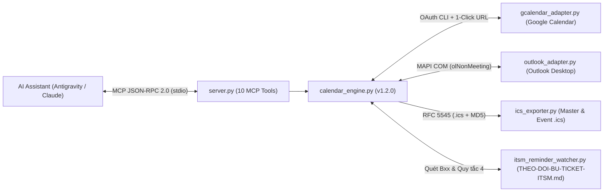

# 📅 DUC_CalendarSync_AIBridge — Multi-Platform Calendar Sync & ITSM Smart Reminder MCP Server (`v1.2.0`)

> **Tác giả (Author):** Nguyễn Duy Đức (`DucWorker97`)  
> **Chuẩn giao thức:** Model Context Protocol (`stdio` JSON-RPC 2.0)  
> **Nền tảng hỗ trợ:** Google Calendar (OAuth CLI & 1-Click Web URL) • Microsoft Outlook Desktop (MAPI COM) • Chuẩn Quốc tế iCalendar RFC 5545 (`.ics`)

---

## 🏗️ Sơ Đồ Kiến Trúc Hệ Thống



---

## 🌟 Tính Năng Cốt Lõi

1. **Đặt, Dời Lịch & Xóa Sự Kiện Tức Thì Đa Nền Tảng (`cal_create_event`, `cal_update_event`, `cal_delete_event`):**
   - Chỉ cần ra lệnh bằng ngôn ngữ tự nhiên trong khung chat AI, MCP Server tự động đẩy, cập nhật (reschedule) hoặc xóa sự kiện đồng thời trên **Google Calendar**, **Microsoft Outlook Desktop** (thư mục `Lịch`, `MeetingStatus = 0` không gửi email làm phiền người khác) và xuất tệp `.ics` chuẩn RFC 5545.
   - Cơ chế bảo vệ tự động 3 chuỗi lịch vận hành cốt lõi khỏi thao tác sửa/xóa nhầm.
2. **Đồng Bộ Chuỗi Lịch Vận Hành Tự Động (`cal_sync_all`):**
   - Tự động duy trì 3 chuỗi lịch định kỳ kèm quy tắc lặp `RRULE`:
     - **`DAILY_BACKUP_1745`** (*17:45 Thứ 2 – Thứ 7*): Sao lưu Đám mây Tự động (Kho Nóng ZIP + Kho Lạnh H.265) & Chưng cất Hòm thư.
     - **`WEEKLY_REPORT_SUN_1500`** (*15:00 Chủ Nhật hàng tuần*): Lập & Kiểm toán 9 Lớp Báo cáo Tuần MES Song ngữ (VI–ZH).
     - **`MONTHLY_ITSM_28_1600`** (*16:00 ngày 28 hàng tháng*): Đối soát Sổ cái Sự cố & Khóa sổ Bù đơn Ticket ITSM Tháng.
3. **Tự Động Nhắc Lịch Khi Có Sự Cố Chờ Bù Đơn ITSM (`cal_remind_pending_itsm`):**
   - Tự động quét sổ cái `THEO-DOI-BU-TICKET-ITSM.md` để phát hiện các Candidate `Bxx` chưa đóng hoặc đang chờ xác thực Mã nhân viên (`V0xxxx`).
   - Tự động ghim sự kiện nhắc việc **`[ITSM-Remind] 🎫 Nhắc Bù Đơn Ticket ITSM`** vào khung giờ hành chính tiếp theo (kèm sẵn mẫu câu hỏi Mã nhân viên song ngữ VI–ZH theo Quy tắc 4).
4. **Đọc Lịch Trình 2 Chiều, Phát Hiện Xung Đột & Bản Tin Đầu/Cuối Ca (`cal_query_schedule`, `cal_check_conflicts`, `cal_daily_briefing`):**
   - Đọc lịch trình thực tế trong ngày/tuần hợp nhất từ Managed Store, Google Calendar và Microsoft Outlook Desktop.
   - Kiểm tra trùng lịch họp (Free-Busy Finder) và tự động đề xuất 3 khung giờ trống gần nhất trong giờ hành chính (`08:00 - 17:30`).
   - Sinh **Bản tin Lịch trình Đầu ca (`MORNING` - 08:00) / Cuối ca (`EVENING` - 17:15)** định dạng Markdown sẵn sàng gửi qua WeChat / Zalo.

---

## 🛠️ Danh Mục 10 Công Cụ MCP (MCP Tools — `v1.2.0`)

| Tên MCP Tool | Mô tả Chức năng |
|---|---|
| `cal_status` | Kiểm tra kết nối Google Calendar OAuth, Microsoft Outlook Desktop MAPI, kho `.ics` và số lượng đơn `Bxx` chờ bù. |
| `cal_sync_all` | Đồng bộ tức thì toàn bộ lịch vận hành chuẩn và lịch tùy chỉnh lên Google Calendar, Outlook Desktop & `.ics`. |
| `cal_create_event` | Đặt lịch sự kiện mới tức thì (hỗ trợ lặp `NONE`, `DAILY_WORKDAYS`, `WEEKLY_SUN`, `MONTHLY_28`). |
| `cal_remind_pending_itsm` | Quét sổ cái sự cố `Bxx` chờ bù đơn / thiếu Mã NV và tự động ghim lịch nhắc trên Google Calendar & Outlook. |
| `cal_list_events` | Liệt kê toàn bộ lịch trình đang quản lý kèm liên kết 1-Click Google Calendar & Outlook Web. |
| `cal_delete_event` | Xóa sự kiện tùy chỉnh theo `event_id` đồng bộ trên kho `.ics`, Microsoft Outlook Desktop và Google Calendar. |
| `cal_query_schedule` | Đọc lịch trình thực tế 2 chiều trong ngày/tuần từ Managed Store, Google Calendar & Outlook Desktop. |
| `cal_check_conflicts` | Kiểm tra xung đột lịch họp tại khung giờ dự kiến và gợi ý 3 khung giờ trống gần nhất. |
| `cal_update_event` | Dời lịch (reschedule) hoặc cập nhật tiêu đề, thời lượng, mô tả, địa điểm của sự kiện tùy chỉnh theo `event_id`. |
| `cal_daily_briefing` | Sinh Bản tin Lịch trình Đầu ca (`MORNING` - 08:00) / Cuối ca (`EVENING` - 17:15) kèm trạng thái ITSM & Checklist. |

---

## 🚀 Hướng Dẫn Cài Đặt & Kiểm Thử

```bash
# 1. Cài đặt thư viện
pip install -r requirements.txt

# 2. Chạy tự kiểm định (Self-Test 10 MCP Tools)
python server.py --selftest

# 3. Tự động đăng ký vào mcp_config.json (Antigravity)
python server.py --register-mcp

# 4. Chạy bộ kiểm thử tự động Pytest (7/7 PASS)
python -m pytest tests/ -q
```
